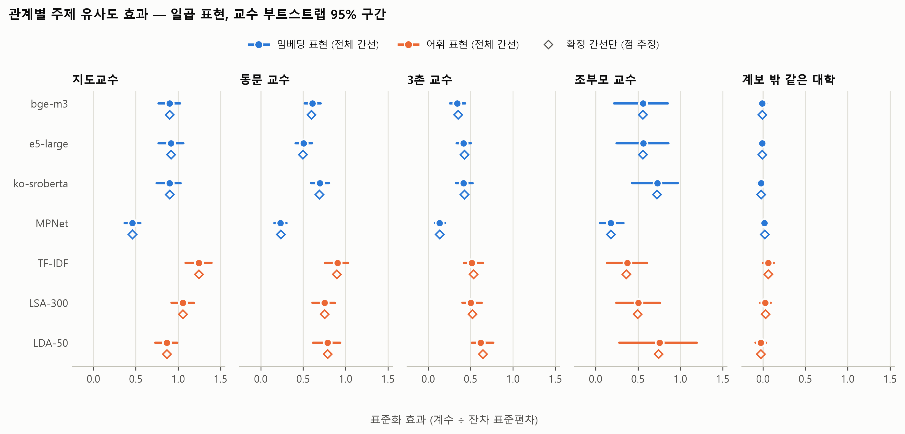

# 부록 — 자료와 방법의 세부, 상세 결과, 공개 파생표, 재현 절차

심사 중인 논문의 부록이다. 투고 원고에는 지면 때문에 싣지 않고 이 저장소에 둔다. 「본문」은 투고 원고를 가리키며, 본문의 표(표 1~7)와 그림(그림 1~4)의 번호는 투고 원고와 같다. 심사를 위해 논문 제목, 투고자, 자료를 공개한 사이트의 주소를 가렸다(가린 곳은 `<SITE>`).

- 부록 A: 자료와 방법의 세부(A.1 학맥 자료, A.2 저자 식별, A.3 말뭉치, A.4 주제 표현, A.5 모형)
- 부록 B: 상세 결과(부록 표 B1~B11, 부록 그림 B1)
- 부록 C: 공개 파생표 목록
- 부록 D: 재현 절차

## 이 부록에 적힌 출처 이름과 저장소 경로

부록의 표와 본문에는 분석할 때 쓴 작업 폴더의 이름이 출처로 적혀 있다. 이 저장소에서는 다음 자리에 있다.

| 부록에 적힌 이름 | 이 저장소의 경로 |
|---|---|
| `공개_파생표_20261122b/` | `data/derived_tables/` |
| `genealogy-library.json`, `학풍_학맥20261122b/_genealogy`, `_genealogy_20261122/` | `data/genealogy/` |
| `학풍_학맥20261122/<이름>/…`, `학풍_학맥20261122b/<이름>/…` | `results/<이름>/…` (측정 방법별 폴더, `국중목차`, `토픽모형`, `역산`, `코호트`, `제자궤적`, `토픽`, `보충`) |
| `학풍_계보강건성_20261122/` | `results/lineage_robustness/` |
| `재분석_비교_20261122.md` | `results/재분석_비교_20261122.md` |
| `그림_20261122b/` | `figures/` |
| `_scripts/…` | `scripts/rerun_20261122/`, `scripts/rerun_20261122b/` |
| 그 밖의 스크립트(`stat_review.py` 등) | `scripts/pipeline/` |

다음은 이 저장소에 넣지 않았다. 이전 판의 파생표(`공개_파생표_20261114`, `공개_파생표_20261101`)와 계산 폴더(`학풍_현행학맥_20261114/`), 토픽 모델 자체(`학풍_토픽_임베딩모형_20261122/`, `학풍_토픽검토_20261120/`), 임베딩을 다시 한 작업 폴더(`학풍_임베딩다양화_20261101/`), 국립중앙도서관 목차 수집 보고서(`학풍_국중목차/`), 그리고 스크립트 `student_trajectory.py`, `tfidf_topic_replication.py`, `embed_variants.py`, `nlk_books_enrich.py`, `nlk_toc_fetch.py`다. 박사학위논문 본문, 학술지 논문 초록, 임베딩 벡터, 논문별 토픽 비중도 넣지 않았다.

---

## 부록 A. 자료와 방법의 세부

본문 3장에서 말로 적은 자료와 방법의 세부다. 수치의 기준일은 각 문단에 적었다.

### A.1 학맥 자료 — 지도교수→학위자 간선

학맥 자료는 두 목록에서 출발한다. 하나는 한국 현대문학 박사학위논문의 통합목록이고, 다른 하나는 국어국문학 관련 학과의 교수 명단이다. 두 목록을 어떻게 모았는지부터 적는다.

**박사학위논문 통합목록(2,189편).** 네 갈래의 서지를 RISS 제어번호로 합친 것이다. 첫째는 김병준·천정환(2020)이 공개한 2000~2019년 현대문학 박사학위논문 서지 1,528편이다. 이 서지는 RISS에서 학과명 '국어국문' 또는 '국문'으로 검색한 석·박사학위논문 서지 21,858건에서 박사논문을 추리고, 어학과 고전문학을 덜어 낸 뒤 두 연구자가 제목·주제어·초록·목차를 읽어 고른 것이다. 둘째는 같은 검색 조건(학과명, 국내 박사, 연도)으로 모은 2020~2026년 서지 가운데 세부 전공 표기와 제목의 작가 이름·주제어로 가린 현대문학 후보 439편이다(포함 152편, 포함 후보 287편). 셋째는 같은 조건으로 1970~1999년 박사 서지를 조회해 고른 204편이다. 넷째는 원문 PDF를 확보해 본문을 색인한 1,593편이다. 갈래 사이에 겹치는 논문은 제어번호가 같으면 하나로 합쳤고, 그 결과가 2,189편이다. 학위 연도로 나누면 1970년대 8편, 1980년대 87편, 1990년대 109편, 2000년대 813편, 2010년대 715편, 2020년대 457편이다. 이 목록에는 한계가 있다. 같은 논문이 다른 제어번호로 두 번 오른 경우가 남아 있을 수 있어 편수가 곧 학위의 수는 아니다. 1970~1999년 부분은 전수가 아니라 선별이고, 2020년 이후 부분에는 연구자가 아직 판정하지 않은 후보가 들어 있다. 통합한 시점에 지도교수 이름이 등록되어 있던 논문은 1,686편이었다. 그 이름의 대부분은 확보한 원문에서 읽어 낸 것(949편)과 앞선 검수 기록에서 확인해 둔 것(602편)이고, RISS 서지의 지도교수 항목이나 주기에서 온 것은 백여 편이다. 한자로 적힌 제목·이름·교명은 원표기를 보존하고, 공개 자료를 만들 때만 두음법칙을 반영해 한글로 바꾸었다.

**교수 명단(705행).** 2026년 10월 27일 기준으로 58개 대학의 학과 누리집에 실린 교수진 소개를 옮긴 것이다. 국어국문학과와 국어교육과, 문예창작학과의 교수는 전공 표기와 관계없이 모두 담았고, 교양대학처럼 다른 소속에 있는 현대소설·현대시 담당 교수도 넣었다. 현직뿐 아니라 누리집에 실린 명예교수와 전직 교수도 담았다. 학과로 나누면 국어국문학 계열 488행, 문예창작 112행, 국어교육 78행, 그 밖 27행이고, 재직 상태로 나누면 현직 432행, 명예교수 140행, 전직·퇴임 129행, 그 밖 4행이다. 한 행에는 대학, 학과, 이름, 전공, 재직 상태, 출처 주소와 확인한 날짜를 적었고, 공개된 자료에서 확인되는 경우에 한해 본인의 박사학위 대학과 연도, 논문 제목, 지도교수를 적었다. 박사학위 대학이 확인된 것은 282행, 학위 연도는 83행, 논문 제목은 20행뿐이어서, 교수 본인의 박사학위논문을 찾는 일은 뒤에 적는 다른 기록에 기대야 했다. 한 사람이 두 대학에 적힌 경우가 있어 행의 수가 곧 사람의 수는 아니다(이름으로 세면 679개). 이 명단도 전수가 아니다. 교수진 소개가 없는 학과와, 물러난 교수를 싣지 않는 학과의 교수는 빠져 있다. 명단에 적힌 직급은 공개 자료에 싣지 않았다.

**지도 관계를 잇는 절차.** 지도교수와 학위자를 잇는 선(간선)은 다음 차례로 만들고 검수했다. (1) 통합목록의 지도교수 항목을 읽어 지도교수 이름을 얻는다. 한자 이름은 한글로 바꾸고, 이름이 아닌 토막은 버리며, 공동 지도는 두 사람 모두에게 잇는다. (2) 그 이름이 같은 대학 소속으로 교수 명단에 있으면 그 교수에게 잇고, 없으면 이름과 대학으로 새 교수 항목을 만든다. 이름이 같아도 대학이 다르면 합치지 않는다. (3) 통합목록에 지도교수가 적혀 있지 않은 논문과 명단 밖 지도교수의 지도논문은 도서관 기록으로 채웠다. 서울대는 중앙도서관 목록에서 지도교수 14명의 박사 지도논문 227건을 전수 조회했고, 다른 대학은 도서관 서지의 지도교수 주기를 논문별로 확인했다. (4) 국립중앙도서관이 공개한 학위논문 기록 전체에서 문학 계열 94,540건을 뽑아 지도교수 주기를 우리 간선과 맞대었다. 일치하는 것은 근거로 덧붙이고, 새로 드러난 지도 관계는 연구자가 검토표에서 한 건씩 정했다. (5) 대학의 학위논문 저장소와 국립중앙도서관, RISS의 세 기록을 맞대어, 세 곳이 일치하면 넣고 어긋나거나 한 곳에만 있으면 연구자가 판단했다. (6) 박사학위논문에 지도교수가 적혀 있지 않은 교수 몇 명은 같은 대학의 석사학위논문에 적힌 지도교수, 또는 지도 학생의 이름을 든 신문 기사를 간접 근거로 삼아 이었고, 간접 근거임을 간선에 표시했다. 2026년 11월 22일 기준 간선 2,089건의 근거는 통합목록의 지도교수 항목 720건, 지도교수명과 소속의 일치 711건, 대학 도서관 서지 201건, 기존 검수 계승 163건, 국립중앙도서관 학위논문 기록의 지도교수 주기 157건, 대학 저장소·국립중앙도서관·RISS 세 기록의 대조 122건(이 가운데 113건은 연구자 판단을 거침), 신문 기사에 따른 간접 연결 7건, 석사학위논문 지도교수 기록에 따른 간접 연결 4건, 그 밖의 개별 확인 4건이다.

**범위.** 이 글의 학맥은 현대문학에 한정한다. 교수 명단의 전공이 고전문학·국어학·한문학인 교수, 국립중앙도서관 기록에서 본인의 박사학위논문이 고전문학·국어학으로 확인된 교수, 그리고 제목으로 보아 고전문학을 다룬 논문의 간선은 범위 밖으로 두었다. 범위 밖으로 둔 교수는 두 차례(2026년 10월 29일, 11월 22일)에 걸쳐 쉰 명 남짓이다.

**같은 사람인가의 판정.** 학위자와 교수가 같은 사람인지는 이름만으로 판정하지 않았다. 명단의 박사 학위 대학·연도·제목, 대학 도서관 기록, 국립중앙도서관 인물 전거, 연구자의 직접 확인을 근거로 '확정', 간접 근거에 따른 '추론', 연구자 지시로 반영했으나 외부 근거가 없는 '미확인'의 3단계로 표시하고, 모든 분석에서 이 상태를 따라 민감도를 본다(B.5절). 학맥 자료는 분석 뒤에도 검수를 이어 갔다. 2026년 11월 4일에는 교수 본인의 박사학위논문 연결 261명분을 교수 명단·국립중앙도서관 전거·같은 이름의 논문 수로 전수 재검토해, 다른 사람의 논문이 붙어 있던 교수 14명의 연결을 풀거나 바꾸고 전거로 확인된 80건을 확정으로 올렸다. 11월 10일에는 국립중앙도서관 학위논문 기록의 지도교수 주기로, 11월 21~22일에는 대학 저장소 기록의 대조와 연구자의 판단 목록 검수로 간선을 보태고 범위 밖 교수를 덜어 냈다.

2026년 11월 22일 기준 학맥 자료는 교수 470명(지도논문이 있는 교수 379명), 학위자 1,841명, 간선 2,089건이고, 교수가 된 학위자를 잇는 교수→교수 간선은 234건(확정 223·추론 8·미확인 3)이다. 분석 표본(논문 1,434편 × 교수 298명)과 계보 관계, 모든 검정은 이 판으로 계산했다. 처음 분석은 2026년 10월 29일 판(간선 1,836건)에서 표본 1,334편 × 324명을 뽑아 했고, 11월 10일 판(간선 1,957건)으로 계보 관계를 바로잡아 다시 했다. 그 결과와의 비교는 B.5절에 있다.

학맥의 구조 지표는 Rossi·Freire·Mena-Chalco(2018)의 계보 지표를 자료에 맞게 줄인 것이다: 직접 제자 수, 지도논문 수, 교수가 된 제자 수와 비율, 후손 수(모든 세대), 세대 수, 지도 기간(첫 제자~마지막 제자 연도), 다음 세대까지의 평균 연수, 모교 잔류 비율, 학위 대학 수.

### A.2 저자 식별 — KAC·ISNI·KCI 연구자 식별자

학위자 1,787명과 교수 483명, 합쳐 이름 2,045개를 국립중앙도서관 LOD 인물 전거(KAC)에 연결했다. 전거 레코드의 활동 분야·소속·저작 제목·생년을 우리 자료와 대조해 A(문학 분야이고 소속 또는 논문 제목이 일치)·B(문학 분야이고 생년 또는 학위 대학이 일치하며 후보 유일)·C(문학 분야이나 동명 여럿)·D(비문학)로 등급을 매겼다. 이름별 최고 등급은 A 722·B 445·C 767·D 54·없음 57이고, 교수 483명 가운데 434명이 A등급이다. 전거 레코드의 99%에 ISNI가 있다. 국립중앙도서관의 학위논문 LOD는 박사학위논문 레코드에 저자의 KAC 링크와 "지도교수: ○○○" 주기를 담고 있어, 우리 박사학위논문 1,888편을 연도·대학·제목으로 대응시키면 A 1,529·A*(논문은 같으나 저자 표기가 다름) 84·B 5·C 1·X(불일치) 173·없음 96이었다. 지도교수 주기가 있는 대응에서 우리 학맥의 지도교수와 일치하는 비율이 압도적으로 높아(1차 대응 534건 중 일치 531건), 학맥 자료가 외부 전거로 검증된다.

KCI 논문의 저자는 KCI 연구자 식별자(cretId)로 묶었다. 이 식별자는 Open API 응답에는 없고 논문 웹페이지의 저자 링크에만 공개되어 있어, 이름이 겹치는 논문 23,512편의 저자 링크를 읽어 식별자 묶음 5,852개를 얻었다. 인물과 cretId의 연결은 (가) KAC 경유 국립중앙도서관·ISNI 저작 제목 일치, (나) 소속 일치, (다) 학위논문 제목 겹침의 순서로 근거를 매기고 A·B·C·D로 등급화했다. KCI는 한 사람에게 소속·시기별로 식별자를 여럿 부여하므로, 인물의 KCI 식별자는 A등급 cretId의 집합으로 정의했다. 교수 486명 가운데 A등급 396명, 학위자 1,665명 가운데 1,007명이다. 이름만 같은 저자를 자동으로 합치지 않는다는 원칙을 모든 단계에서 지켰고, 동명 인물이 같은 KAC를 받은 교수 13명은 전거를 비워 두었다(교수 묶음은 cretId로 만들었으므로 분석에는 영향이 없다).

### A.3 말뭉치 — KCI 학술지 논문과 박사학위논문

교수의 연구 묶음은 KCI Open API로 수집한 국어국문학·문학 학술지 124종 82,344편(2000–2026)의 서지·국문 초록(72,042편)이다. 이 가운데 교수의 A등급 cretId 집합에 속한 논문을 제목 정규화로 중복을 제거해 묶었다. 문서가 5편 이상 모인 교수는 324명(논문 6,435편)이며, 이 가운데 2026년 11월 22일 판 학맥에 교수로 남은 298명, 논문 5,967편(교수당 중앙값 17편, 최소 5·최대 87편)이 본 분석의 교수 묶음이다. 제자 쪽 문서는 박사학위논문이다. 임베딩 분석에서는 제목과 본문 색인에서 추출한 인물·개념어 태그를, 어휘 분석에서는 본문 전체(인용·각주·참고문헌 제외)를 썼다. 같은 자료로 KCI 참고문헌 1,970,465행도 수집했으나(연결된 인용 간선 438,200건), 이 논문에서는 쓰지 않고 후속 연구로 남긴다.

분석 표본은 2026년 11월 22일 판 학맥의 간선 가운데 지도교수의 KCI 묶음이 있는 박사학위논문 1,434편(1986–2026, 중앙값 2014; 1980년대 5·1990년대 23·2000년대 353·2010년대 630·2020년대 423편; 76개 대학, 고려대 161·서울대 143·연세대 96·한양대 90·충남대 74·경희대 72·이화여대 54편) × 교수 298명이다. 어휘 표현은 본문 색인이 있는 1,145편이 대상이다. 표본의 학위자 동일인 판정은 미확인 1,314·확정 112·추론 8건으로, 미확인이 대부분이다. 이는 학위자의 다수가 교수가 아니어서 판정할 외부 근거가 없다는 뜻이며, 지도교수→논문 간선 자체는 서지로 확인된 것이다. 교수 298명의 박사학위 연도는 학맥 간선 175명, 국립중앙도서관 박사학위논문 KAC 대응 97명, 이름과 학과의 유일 일치 9명 등으로 283명을 채웠다.

이 표본은 처음 분석의 표본(2026년 10월 29일 판 학맥, 1,334편 × 324명)을 새 학맥에 맞추어 다시 잡은 것이다. 교수의 KCI 묶음은 그대로 두었다. 범위 밖으로 빠지는 등 새 학맥에 교수로 남지 않은 26명과 그 지도 관계 36건을 덜고, 남은 교수가 지도한 것으로 새로 확인된 논문 136편을 더했다. 새로 더한 논문은 처음과 같은 규칙(제목과 공개 태그)으로 임베딩했고, 앞선 표본의 논문 40편을 같은 절차로 다시 임베딩해 저장된 벡터와 일치함을 확인했다. 새로 더한 논문은 대부분 본문 색인이 없어 어휘 표현과 토픽 모델의 표본에는 들어가지 않는다. 새 학맥에 새로 생긴 교수는 KCI 묶음이 없어 비교 대상 교수(열)에 넣지 못했으나, 계보 관계를 구성하는 데에는 쓰였다.

### A.4 주제 표현

주제의 닮음은 네 가지 표현으로 측정했다. 본 분석은 다국어 문장 임베딩 bge-m3(최대 길이 512)로, 제자 논문은 제목과 태그를, 교수 묶음은 논문별 제목·키워드·초록 600자의 벡터를 평균한 것이다. 재현은 어휘 표현 셋으로 했다: 형태소 분석(kiwipiepy)으로 뽑은 명사 어휘 30,000개의 sublinear TF-IDF, 그 300차원 잠재의미분석(LSA), 그리고 K=50 LDA 토픽 분포(문서 벡터는 √θ, 내적은 Bhattacharyya 계수). 어휘 표현의 어휘는 KCI 초록 72,042편과 박사학위논문 본문 1,593편을 합친 말뭉치에서 만들었다. 임베딩 모델 선택에 결론이 기대지 않는지 보려고, bge-m3와 학습 계열이 다른 세 모델(한국어 특화 ko-sroberta-multitask 768차원, 다국어 multilingual-e5-large 1024차원, 다국어 paraphrase-multilingual-mpnet-base-v2 768차원)로 같은 문서·간선·묶음을 다시 임베딩했다(Wang 외 2024; Reimers·Gurevych 2019; Ham 외 2020). 박사학위논문 본문과 KCI 초록은 장르와 길이가 달라 원 코사인의 수준은 표현마다 다르므로, 비교는 표준화 효과(계수/잔차 표준편차)와 순서로 한다.

### A.5 모형 — 이원 고정효과 잔차 회귀와 네 가지 검정

논문 i와 교수 j의 유사도 s_ij에서 논문 평균과 교수 평균을 뺀 이원 고정효과 잔차 r_ij를 종속변수로 한다. 원 코사인은 묶음이 '일반적'인 교수일수록 모든 논문과 가까워 편향되므로 잔차화가 필수다. 설명변수는 교수→교수 간선으로 구성한 관계 더미다: 지도교수, 조부모(지도교수의 지도교수), 동문(같은 지도교수의 다른 제자 교수), 3촌(조부모의 다른 제자, 곧 지도교수의 동문), 같은 계보 기타(같은 뿌리의 나머지), 계보 밖 같은 대학(제자의 학위 대학에 소속된 계보 밖 교수), 그리고 계보 관계이면서 같은 대학일 때 켜지는 추가 더미. 기준은 다른 대학·계보 밖 교수다. 관계의 이름은 성별이 드러나지 않게 조부모·동문·3촌으로 적는다. 영어권 계보 연구가 grandmentor, academic siblings, aunts and uncles로 부르는 관계에 해당하며(Chariker 외 2017; Tol 2024), 3촌은 촌수로 적은 것이다. 분석 스크립트와 공개 파생표의 관계 부호 grand·sibling·uncle이 각각 이에 대응한다. 표준오차는 같은 논문과 같은 교수가 수천 쌍에 반복 들어가는 상관을 반영하는 논문·교수 양방향 클러스터(Cameron·Gelbach·Miller 2011)이며, 관계 항 7개에 Holm 순차 보정을, 교수 재표집과 논문 재표집 부트스트랩(300회) 95% 구간을, 같은 대학 안에서 교수 정체를 섞어 계보 표지만 파괴하는 순열 검정(300회)을 함께 쓴다. 순열은 같은 대학 안에서 섞으므로 '계보 밖 같은 대학' 항에는 정보가 없고, 이 항은 클러스터 t와 부트스트랩 구간으로 판단한다.

전승 방향은 지도교수 묶음을 제자의 학위 연도 기준 창(학위 전 10년, 전후 3년, 후 10년, 위약으로 11~30년 전과 11~30년 후)으로 나눠 창별 행렬을 따로 잔차화해 본다. 제자 궤적은 학위자 본인의 KCI 논문을 학위 후 경과 연수 구간별로 교수 묶음과 비교한다. 강건성은 교수→교수 간선을 판정 상태별로 제한한 재추정(확정만 223건, 확정+추론 231건, 전체 234건), 계보 뿌리를 더한 삼방향 클러스터와 뿌리 단위 와일드 클러스터 부트스트랩(499회), 서울대 뿌리 계보를 빼거나 층화한 재추정, 학맥의 앞선 판과의 비교, 교수 묶음 자료를 국립중앙도서관 저서로 바꾼 재추정으로 본다.

## 부록 B. 상세 결과

본문 4장의 표와 그림에 싣지 않은 세부 결과다. 본문에 제시한 표(표 2, 표 5, 표 6)의 값은 여기서 되풀이하지 않고, 추정의 세부와 본문에서 다루지 않은 조건만 싣는다. 부록에서는 지도 관계 하나를 그래프의 '간선'으로, 교수의 연구 묶음을 '묶음'으로, 닮음을 '잔차'로 적는다. 토픽 모델(LDA, K=50)의 값은 재검토 중인 옛 모델의 것이어서 잠정이며, 새 모델이 정해지면 바꾼다. 계보별 특이 토픽 표와 그림은 같은 까닭으로 이 판에서 뺐다.

### B.1 학맥과 분석 표본의 세부

간선의 학위 연도는 1976년부터 2026년까지이며 2000년대 717·2010년대 782·2020년대 452건으로 2000년 이후가 대부분이다. 학위 대학은 서울대 262·고려대 197·한양대 120·경희대 102·연세대 101·충남대 85건 순이다. 지도논문이 있는 교수 379명의 지도논문 수는 평균 5.5편이다. 본문 표 2의 후손 수에는 석사학위논문 지도교수 기록에 따른 간접 연결 4건과 신문 기사의 지도 학생 명단에 따른 간접 연결 7건이 포함되어 있다. 이전 판에서 열째이던 유성호(한양대) 계보(후손 41명·1세대)는 정한숙 계보가 들어오면서 열한째가 되었다. 분석 표본은 이 판에서 다시 잡았다. 교수 묶음의 KCI 논문은 그대로 두고, 새 학맥에 교수로 남지 않은 26명(대부분 고전문학·국어학 등 범위 밖으로 뺀 교수)과 그 지도논문 36편을 빼고 새로 확인된 지도 관계의 논문 136편을 더했다(A.3절). 부록 표 B1은 본문 표 1에 없는 항목이다.

**부록 표 B1. 자료 개요의 세부** (출처: `학풍_학맥20261122b/_genealogy`의 `genealogy-library.json`, `공개_파생표_20261122b/theses.csv`·`professors.csv`·`methods.json`)

| 구분 | 값 |
|---|---|
| 학맥 자료(2026-11-10, 이전 판) | 교수 486명(지도논문 있음 393) · 학위자 1,721명 · 지도 간선 1,957건 · 교수→교수 간선 220건(확정 209·추론 8·미확인 3) |
| 학맥 자료(2026-10-29, 처음 분석한 판) | 교수 486명(지도논문 있음 389) · 학위자 1,597명 · 지도 간선 1,836건 · 교수→교수 간선 223건(확정 139·추론 30·미확인 54) |
| KCI 말뭉치 | 학술지 124종 · 82,344편(2000–2026) · 국문 초록 72,042편 |
| 저자 식별 | KAC A등급 이름 722(교수 434/483) · KCI cretId A등급 교수 396/486, 학위자 1,007/1,665 |
| 분석 표본의 쌍 수 | 임베딩 1,434편 × 298명 = 427,332쌍 · 어휘(본문 색인이 있는 1,145편) × 298명 = 341,210쌍 |
| 계보(분석 표본) | 뿌리 141개 · 서울대에 뿌리를 둔 계보(정한모·전광용·신범순·박성창·우한용)가 논문의 26%(374편) |

### B.2 관계별 효과의 세부

부록 표 B2은 본문 표 3의 추정 세부다(bge-m3, 1,434편 × 298명; 표본과 계보 관계 모두 2026-11-22 판 학맥). 양방향 클러스터 t, 다중비교 보정을 거친 유의확률, 순열 검정과 부트스트랩의 결과, 확정 간선만으로 계보를 구성한 추정치를 함께 싣는다. 조부모 항은 쌍 185개가 조부모 교수 22명에게서만 나오고(상위 세 명이 110쌍, 59%) 교수 쪽 표준오차가 논문 쪽의 2.0배여서, 본문에서는 확정된 결과로 다루지 않았다(본문 4장). 부록 그림 B1은 일곱 표현의 표준화 효과를 구간과 함께 그린 것이다.

**부록 표 B2. 관계별 잔차 유사도 회귀(bge-m3, 본 분석)** (출처: `공개_파생표_20261122b/regression_results.csv`, representation=bge, edge_tier=all; 확정만 열은 edge_tier=confirmed)

| 관계 | 계수 | 양방향 t | Holm p | 순열 p | 교수 부트스트랩 95% | 표준화 | 쌍 | 확정 간선만 계수(t) |
|---|---|---|---|---|---|---|---|---|
| 지도교수 | +0.0266 | 14.6 | <0.001 | <0.003 | [+0.0227, +0.0302] | 0.90 | 1,434 | +0.0266 (14.6) |
| 동문 교수 | +0.0180 | 10.8 | <0.001 | <0.003 | [+0.0153, +0.0209] | 0.61 | 2,381 | +0.0177 (10.1) |
| 3촌 교수 | +0.0101 | 6.3 | <0.001 | <0.003 | [+0.0076, +0.0129] | 0.34 | 2,763 | +0.0101 (6.2) |
| 조부모 교수 | +0.0166 | 3.4 | 0.003 | 0.013 | [+0.0065, +0.0252] | 0.56 | 185 | +0.0166 (3.4, Holm 0.003) |
| 같은 계보 기타 | −0.0005 | −0.8 | 0.86 | 0.27 | [−0.0017, +0.0006] | −0.02 | 14,210 | −0.0006 (−0.9) |
| 계보 밖 같은 대학 | −0.0002 | −0.3 | 0.86 | (정보 없음) | [−0.0013, +0.0011] | −0.01 | 7,181 | −0.0002 (−0.3) |
| 같은 대학×계보 | −0.0022 | −1.2 | 0.74 | 0.62 | [−0.0061, +0.0012] | −0.07 | 2,067 | −0.0021 (−1.1) |

주: 종속변수 = 코사인의 이원 고정효과 잔차(잔차 SD 0.0296). 기준 = 다른 대학·계보 밖. 표준오차는 논문·교수 양방향 클러스터. 계보 관계는 교수→교수 간선 234건(확정 223건)으로 구성했다. 순열은 같은 대학 안에서 교수 정체를 섞은 것이라 '계보 밖 같은 대학' 항에는 정보가 없다. 부트스트랩·순열 각 300회.

**부록 그림 B1. 관계별 주제 유사도 효과.** 제자 박사논문 × 교수 묶음의 잔차 유사도를 관계 더미로 회귀한 계수를 잔차 표준편차로 나눈 표준화 효과. 가로선 = 교수 클러스터 부트스트랩 300회 95% 구간, 채운 점 = 전체 간선, 빈 마름모 = 확정 간선만으로 계보를 만든 추정치(2026-11-22 판 학맥에서는 교수→교수 간선의 94%가 확정이어서 두 추정치가 거의 겹친다). 일곱 표현(bge-m3·e5-large·ko-sroberta·MPNet 임베딩, TF-IDF·LSA·LDA 어휘)에서 지도교수 > 동문 > 3촌의 순서와 「계보 밖 같은 대학 ≈ 0」이 재현된다. 조부모는 구간이 넓어 순서를 정하기 어렵다. 출처: `공개_파생표_20261122b/regression_results.csv`(그림 데이터 `그림1_data.csv`).

학위 연대별로 나누면(≤2004년 136편, 2005–2014년 590편, 2015년 이후 708편) 지도교수 효과는 +0.0212·+0.0258·+0.0272, 동문 +0.0135·+0.0200·+0.0169, 계보 밖 같은 대학 −0.0006·+0.0004·−0.0005로 순서가 모든 연대에서 같다. 지도교수 효과가 최근 연대에서 큰 것은 KCI가 2000년 이후만 담고 있어 2004년 이전 학위자의 지도교수 묶음이 학위 후 논문으로만 채워지는 자료 범위 효과이므로, "최근일수록 전승이 강하다"고 읽지 않는다.

코호트 효과는 동문 효과를 학위 연도 차로 나눠 본다. 동문 교수 효과는 연도 차 5년 이하 +0.0188, 6–15년 +0.0164로 연도 차가 벌어져도 유지된다. 16년 이상은 +0.0077이나 쌍이 56개뿐이어서 판단하기 어렵다. 같은 대학·계보 밖 교수 가운데 연도 차 5년 이하(다른 지도교수 아래 같은 시기 같은 대학원에 있던 순수 코호트)는 −0.0001, 6–15년 +0.0009, 16년 이상 −0.0010이다. 동문 효과는 같은 시기에 함께 배운 코호트 효과가 아니라 지도교수를 통한 계보 효과이며, 코호트 자체는 주제를 닮게 하지 않는다. 지도교수 효과를 교수의 학위 후 경과 연수로 나누면 10년 이하 +0.0203, 11–20년 +0.0284, 21–30년 +0.0262, 30년 초과 +0.0255로 경력이 쌓인다고 한쪽으로 커지거나 줄지 않는다.

### B.3 제자 궤적의 세부

학위자 가운데 A등급 cretId가 있고 본인 KCI 논문이 있는 882명의 논문 9,719편(학위 후 7,501편, 발표 당시 소속이 학위 대학과 다른 논문 4,757편)을 교수 묶음과 비교했다(부록 표 B3, 본문 그림 4). 지도교수 전체 묶음과의 잔차는 학위 직후 +0.0219에서 16년 이상 뒤 +0.0203로 거의 줄지 않는다(학위 후 논문 4편 이상인 485명의 제자별 기울기 평균 −0.00055/년, 95% [−0.00086, −0.00025]; 멀어지는 사람 60%). 물려받은 주제(지도교수의 학위 전 10년 창)로 좁히면 더 뚜렷이 줄어 +0.0292에서 +0.0134로 16년에 절반 아래가 된다. 즉 제자는 지도교수의 옛 주제에서는 천천히 멀어지되 지도교수가 뒤에 쓰는 연구와는 계속 비슷하게 움직이며, 동문 교수와는 경력이 쌓일수록 더 닮아진다(+0.0129 → +0.0216, 16년 이상 구간에서는 지도교수 효과와 같은 크기). 본인 박사학위논문과의 코사인은 0.488에서 0.416으로 서서히 낮아진다.

재직 대학 동료 효과는 작고 한때뿐이다. 학위 후 4–6년에 +0.0022(t 2.3), 7–10년에 +0.0034(t 3.2, 지도교수 효과의 1/6)로 잠깐 유의하고 11년 뒤에는 0과 구별되지 않는다(11–15년 +0.0014, t 1.1; 16년 이상 −0.0003). 학위 대학에 남은 사람은 7–10년 +0.0047, 11–15년 +0.0039이고, 옮긴 사람은 새 재직 대학 동료 쪽으로 가지 않으며(7–10년 +0.0028, 16년 뒤 −0.0025) 출신 대학 동료를 유지하지도 않는다(16년 뒤 −0.0027). 대학 효과는 경력 뒤에도 나타나지 않으며, 학풍의 단위는 끝까지 계보다.

**부록 표 B3. 제자 본인 KCI 논문과 교수 묶음의 잔차(학위 후 경과 연수별)** (출처: `공개_파생표_20261122b/trajectory_bins.csv`, `trajectory_regression.csv`)

| 학위 후 | 지도교수(전체 묶음) | 물려받은 주제(지도교수 학위 전 10년 창) | 본인 박사논문 코사인 | 재직 대학 동료(계보 밖) | 동문 교수(회귀 t) |
|---|---|---|---|---|---|
| 학위 전 −5…−1 | +0.0258 | +0.0292 | 0.488 | +0.0014 | — |
| 0 | +0.0219 | +0.0214 | 0.496 | +0.0004 | +0.0129 (6.3) |
| 1–3 | +0.0235 | +0.0246 | 0.462 | +0.0004 | +0.0144 (9.4) |
| 4–6 | +0.0208 | +0.0208 | 0.441 | +0.0029 (회귀 +0.0022, t 2.3) | +0.0161 (7.7) |
| 7–10 | +0.0213 | +0.0199 | 0.428 | **+0.0036** (회귀 +0.0034, t 3.2) | +0.0161 (8.0) |
| 11–15 | +0.0203 | +0.0179 | 0.420 | +0.0010 | +0.0180 (7.0) |
| 16+ | +0.0203 (회귀 t 4.0) | +0.0134 [+0.0052, +0.0224] | 0.416 | −0.0008 | **+0.0216** (7.2) |

주: 구간 평균은 제자 재표집 부트스트랩, 회귀는 제자·교수 양방향 클러스터 SE. 조부모 +0.0119(t 2.9)·3촌 +0.0054(t 3.1)도 학위 뒤 논문에서 유지. 제자의 논문 목록은 처음 실행(2026-10-30)의 것 가운데 새 표본에 남은 지도 관계의 것만 썼고, 이번 판에서 새로 들어온 지도 관계의 학위자 논문은 찾지 않았다.

### B.4 낱말 빈도·토픽 표현의 세부

결론이 임베딩 모델 하나에 기대지 않는지 보려고 같은 표본(본문이 있는 1,145편 × 298명)에서 TF-IDF·LSA·LDA로 다시 추정했다(부록 표 B4). 네 표현 모두 지도교수(표준화 +0.84~+1.24) ≥ 동문(+0.64~+0.90) > 3촌(+0.37~+0.62)·조부모(+0.37~+0.76) > 같은 계보 기타(0)의 순서이고, 계보 밖 같은 대학은 네 표현 모두에서 0과 구별되지 않는다(bge −0.0003, TF-IDF +0.0012(t 1.9, Holm p 0.15), LSA +0.0011(t 0.8), LDA −0.0027). 이전 판 학맥(2026-11-10)에서는 TF-IDF(+0.0018, t 3.5)·LSA(+0.0026, t 2.4)에서 작게 양이었으나, 새 학맥에서는 TF-IDF의 값도 지도교수 효과의 5%에 그치고 유의하지 않다. 시계열(학위 전 10년 창이 최대)도 LSA·LDA에서 재현된다.

**부록 표 B4. 표현별 관계 효과(계수, 양방향 t, 표준화 효과)** (출처: `공개_파생표_20261122b/regression_results.csv`, edge_tier=all)

| 관계 | bge(부분표본) | TF-IDF | LSA(300) | LDA(K=50) |
|---|---|---|---|---|
| 지도교수 | +0.0245 (13.5)* / 0.84 | +0.0245 (15.2)* / 1.24 | +0.0400 (14.1)* / 1.05 | +0.0973 (12.6)* / 0.86 |
| 동문 교수 | +0.0185 (9.3)* / 0.64 | +0.0178 (11.5)* / 0.90 | +0.0287 (9.7)* / 0.75 | +0.0888 (8.4)* / 0.79 |
| 3촌 교수 | +0.0108 (6.3)* / 0.37 | +0.0102 (7.5)* / 0.52 | +0.0190 (7.2)* / 0.50 | +0.0695 (8.0)* / 0.62 |
| 조부모 교수 | +0.0159 (3.1)* / 0.54 | +0.0074 (3.0)* / 0.37 | +0.0192 (3.6)* / 0.51 | +0.0852 (2.9)* / 0.76 |
| 같은 계보 기타 | +0.0001 (0.2) / 0.00 | −0.0002 (−0.3) / −0.01 | −0.0003 (−0.3) / −0.01 | +0.0003 (0.1) / 0.00 |
| 계보 밖 같은 대학 | −0.0003 (−0.4) / −0.01 | +0.0012 (1.9) / 0.06 | +0.0011 (0.8) / 0.03 | −0.0027 (−0.8) / −0.02 |
| 같은 대학×계보 | −0.0014 (−0.8) / −0.05 | +0.0004 (0.2) / 0.02 | +0.0000 (0.0) / 0.00 | −0.0065 (−0.6) / −0.06 |

주: 표본 1,145편 × 298명. `*` Holm p<0.05. 조부모의 순열 p는 TF-IDF 0.190·LSA 0.067으로 비유의, bge 0.010·LDA 0.007.

### B.5 강건성 — 판정 단계·서울대 계보·표현·학맥 판 사이의 비교·묶음 자료·토픽 모델

**판정 단계.** 동문·3촌·조부모 관계는 교수→교수 동일인 간선 234건에 기댄다. 2026년 11월 22일 판 학맥에서는 이 가운데 223건이 확정(추론 8·미확인 3)이다. 간선을 확정만으로 제한해도 지도교수 계수는 그대로이고(제한이 지도교수→논문 간선에 닿지 않음), 동문 +0.0177(t 10.1)·3촌 +0.0101(t 6.2)·조부모 +0.0166(t 3.4, Holm p 0.003, 쌍 185)은 전체 간선의 추정치(+0.0180·+0.0101·+0.0166)와 거의 같다(부록 표 B2 마지막 열). 확정과 추론을 합친 231건으로도 동문 +0.0180·3촌 +0.0101·조부모 +0.0166으로 같은 자리에 있다. 미확인은 3건뿐이다. 계보 밖 같은 대학 항은 세 단계에서 같다(−0.0002). 즉 계보 효과와 대학 효과 0의 결론은 동일인 판정이 불확실한 간선에 기대지 않는다.

**서울대 계보.** 서울대에 뿌리를 둔 계보(정한모·전광용·신범순·박성창·우한용)가 논문의 26%(374편), 동문 쌍의 40%, 3촌 쌍의 73%, 조부모 쌍의 64%(정한모 계보 단독 109/185)를 차지한다. 부록 표 B5처럼 정한모 계보를 빼도, 서울대 뿌리 계보를 모두 빼도(1,060편) 지도교수 +0.0263(t 11.9)·동문 +0.0197(t 8.6)은 그대로이고 계보 밖 같은 대학은 −0.0000으로 0이며, 다른 일곱 표현도 같다(TF-IDF의 계보 밖 같은 대학만 +0.0013, t 1.9). 3촌은 서울대 뿌리 계보를 빼면 약해진다. bge-m3에서 전체 +0.0101(t 6.3)이던 것이 +0.0068(t 2.1, 쌍 740)이 되고, 다른 표현에서도 양이기는 하나 t가 1.8(MPNet)에서 3.5(TF-IDF) 사이다. 3촌 쌍의 넷에 셋이 서울대 뿌리 계보에 있으므로 이 항의 크기는 서울대 계보 밖에서 덜 확실하다. 서울대 계보 안과 밖의 층화 차이 검정은 여덟 표현 × 다섯 항 가운데 e5-large의 동문 항(차이 t −2.7, 서울대 밖에서 더 큼) 하나를 빼면 |t| ≤ 1.8이다. 계보 뿌리를 더한 삼방향 클러스터 t는 bge-m3에서 지도교수 14.7·동문 10.3·3촌 8.8이고, 뿌리 단위 와일드 클러스터 부트스트랩 p는 세 항 모두 0.002 미만(499회)이다. 다만 3촌의 와일드 부트스트랩 p는 여덟 표현 가운데 다섯(본문 표본의 bge-m3 0.12, LSA 0.07, LDA 0.20, e5-large 0.27, MPNet 0.27)에서 5%를 넘는다. 조부모 항은 서울대 뿌리 계보를 뺀 1,060편(66쌍; 본문 표본은 876편·60쌍)에서도 일곱 표현 모두 양이고 양방향 t는 2.0에서 4.0 사이다(bge-m3 +0.0079(t 2.0) · e5 +0.0024(t 2.5) · ko-sroberta +0.0243(t 4.0) · MPNet +0.0086(t 2.2) · TF-IDF +0.0078(t 2.4) · LSA +0.0168(t 3.4) · LDA +0.0817(t 4.0)). bge-m3에서 정한모 계보만 빼도 +0.0083(t 2.3, 쌍 76)이다. 그러나 이를 3세대 전승이 계보를 가리지 않는다는 증거로 읽기는 이르다. 쌍이 66개뿐이어서 구간이 넓고, bge-m3의 뿌리 단위 와일드 부트스트랩 p는 0.09로 5% 기준에 못 미친다(다른 여섯 표현은 0.002 미만). 또 학맥이 보완될 때마다 유의한 표현의 수가 달라졌다(같은 분석에서 2026-10-29 판은 셋만 유의했고, 2026-11-10 판은 일곱 모두 t가 2.5 이상이었다).

**부록 표 B5. 계보를 빼고 다시 추정(bge-m3, 양방향 t)** (출처: `학풍_계보강건성_20261122/lineage_robustness_results.csv`)

| 표본 | 논문 | 지도교수 | 동문 | 3촌 | 조부모(쌍) | 계보 밖 같은 대학 |
|---|---|---|---|---|---|---|
| 정한모 계보 제외 | 1,198 | +0.0258 (12.3) | +0.0194 (9.5) | +0.0082 (4.0) | +0.0083 (2.3) 76 | −0.0001 (−0.1) |
| 전광용 계보 제외 | 1,310 | +0.0269 (14.4) | +0.0183 (10.3) | +0.0101 (5.5) | +0.0168 (3.6) 175 | −0.0001 (−0.2) |
| 정한모+전광용 제외 | 1,074 | +0.0261 (12.0) | +0.0197 (8.7) | +0.0072 (2.3) | +0.0079 (2.0) 66 | +0.0001 (0.1) |
| 정한숙 계보 제외 | 1,284 | +0.0272 (14.3) | +0.0154 (10.2) | +0.0111 (6.4) | +0.0179 (2.9) 156 | −0.0000 (−0.0) |
| 서울대 뿌리 계보 전부 제외 | 1,060 | +0.0263 (11.9) | +0.0197 (8.6) | +0.0068 (2.1) | +0.0079 (2.0) 66 | −0.0000 (−0.0) |

**표현.** B.4절의 어휘 표현에 더해, bge-m3와 학습 계열이 다른 임베딩 세 모델로 같은 문서·간선·묶음을 다시 임베딩해 회귀를 돌렸다(부록 표 B6, 부록 그림 B1). 일곱 표현 모두에서 지도교수가 가장 크고 동문이 그다음이며 3촌이 그 뒤를 잇는다. 조부모는 점 추정이 표현에 따라 3촌보다 크기도 작기도 하고 구간이 넓으며, 같은 계보 기타는 0이다. 계보 밖 같은 대학은 일곱 표현 어디에서도 0과 구별되지 않는다. 임베딩 네 모델은 표준화 −0.02~+0.02(Holm p ≥ 0.77)이고, 2026-11-10 판에서 작게 유의하던 어휘 표현 TF-IDF·LSA(+0.09·+0.07, Holm p 0.002·0.043)도 이 판에서는 +0.06·+0.03으로 유의하지 않다(Holm p 0.154·1.000). 표준화 효과는 ko-sroberta(지도교수 +0.90, 동문 +0.70, 3촌 +0.42)와 e5-large(+0.92, +0.50, +0.42)가 bge-m3(+0.90, +0.61, +0.34)와 같은 자리에 놓이고, 패러프레이즈용으로 학습된 MPNet은 신호가 전반적으로 약하나(+0.46, +0.23, +0.13) 순서는 같다. 전승 방향(학위 전 10년 창 최대, 학위 11년 뒤 위약 창 최소)도 창을 나눌 수 있는 여섯 표현(TF-IDF 제외) 모두에서 재현된다. 조부모 항은 일곱 표현 가운데 여섯(MPNet 제외)이 Holm 유의하고 확정 간선만으로도 같으나, 표준화 효과가 +0.18(MPNet)에서 +0.76(LDA)까지 표현에 따라 네 배 차이가 나고 순열 p는 TF-IDF 0.19·MPNet 0.13·LSA 0.07로 유의하지 않다. 즉 2세대 효과와 대학 효과 0의 결론은 임베딩 모델 선택에 기대지 않는다.

**부록 표 B6. 본문 표 6의 유의확률(Holm 보정)** (출처: `공개_파생표_20261122b/regression_results.csv`)

| 표현 | 조부모(전체 간선) | 조부모(확정 간선만) | 계보 밖 같은 대학(전체 간선) |
|---|---|---|---|
| bge-m3(본 분석) | 0.003 | 0.003 | 0.86 |
| multilingual-e5-large | 0.002 | 0.002 | 0.78 |
| ko-sroberta-multitask | <0.001 | <0.001 | 0.84 |
| multilingual-mpnet | 0.053 | 0.053 | 0.98 |
| TF-IDF | 0.012 | 0.013 | 0.15 |
| LSA(300) | 0.001 | 0.001 | 1.00 |
| LDA(K=50) | 0.014 | 0.014 | 1.00 |

주: 표준화 효과의 값은 본문 표 6에 있다. 지도교수·동문·3촌은 모든 표현·단계에서 Holm p<0.001이다(MPNet의 3촌만 0.001~0.002). 계보 밖 같은 대학은 어느 표현·단계에서도 Holm p<0.05가 아니다(확정 간선만 쓸 때 가장 작은 값은 TF-IDF의 0.154). 절대 계수는 공간마다 달라(e5는 코사인 분산이 작아 계수가 bge의 1/4) 비교에는 표준화 효과와 t만 쓴다.

**학맥 판 사이의 비교.** 학맥 자료는 분석을 하는 동안에도 검수가 이어져 두 번 바뀌었다. 처음 분석은 2026-10-29 판(교수→교수 간선 223건: 확정 139·추론 30·미확인 54)으로 했고, 교수 본인 박사학위논문 연결을 전수 재검토한 2026-11-10 판(220건: 확정 209·추론 8·미확인 3)에서는 표본과 벡터를 그대로 둔 채 계보 관계만 다시 구성했다. 이 논문의 수치는 그 뒤 대학 저장소·국립중앙도서관·RISS의 지도교수 기록을 대조해 간선을 보태고 고전문학·국어학 전공 교수를 범위 밖으로 뺀 2026-11-22 판(234건: 확정 223·추론 8·미확인 3)의 것이며, 이번에는 표본도 다시 잡았다(A.1절). 2026-11-10 판과 비교하면 교수→교수 간선은 빠진 것 없이 13건이 더해졌고(분석 교수 안에서는 105건에서 106건), 표본 교수는 324명에서 298명으로(범위 밖 교수 등 26명이 빠짐), 지도교수→논문 간선은 1,334건에서 1,434건으로(36건이 빠지고 136건이 더해짐), 본문이 있는 표본은 1,177편에서 1,145편으로 바뀌었다. 교수 묶음의 벡터는 같다. 부록 표 B7는 두 판의 결과를 나란히 놓은 것이다. bge-m3에서 지도교수는 +0.0263에서 +0.0266으로, 조부모는 +0.0167(쌍 165)에서 +0.0166(쌍 185)으로 거의 움직이지 않았고, 동문은 +0.0180 그대로다(쌍 2,143 → 2,381). 달라진 것은 둘이다. 첫째, 3촌이 +0.0121(쌍 2,159)에서 +0.0101(쌍 2,763)로 작아졌다. 새 학맥에서 고려대의 여러 계보가 정한숙을 뿌리로 하는 한 계보로 묶이면서 3촌 쌍이 늘었는데(정한숙 계보의 3촌 쌍 573개), 이 계보를 빼면 +0.0111(t 6.4)이어서 줄어든 폭의 일부가 여기서 온다. 둘째, 계보 밖 같은 대학이 +0.0005에서 −0.0002가 되었고, 2026-11-10 판에서 작게 유의하던 TF-IDF·LSA의 이 항(Holm p 0.002·0.043)이 유의하지 않게 되었다(0.154·1.000). 조부모 항은 두 판 모두 일곱 표현 가운데 여섯(MPNet 제외)에서 Holm 유의하고, Holm p는 일곱 표현 모두에서 같거나 내려갔다(bge-m3 0.026 → 0.003). 그러나 2026-10-29 판에서는 확정 간선만으로 제한하면 넷(e5·ko-sroberta·LSA·LDA)에서만 유의했다. 교수→교수 간선 몇십 건의 교체로 유의한 표현의 수가 바뀐다는 사실은 조부모 항이 소수의 간선에 기대고 있음을 뜻하며, 학맥이 다시 보완되면 이 항은 또 달라질 수 있다. 2세대 효과와 「계보 밖 같은 대학 0」의 결론은 세 판에서 같다. 2026-10-29 판과 2026-11-10 판의 비교는 `공개_파생표_20261101`·`공개_파생표_20261114`에 있다.

**부록 표 B7. 학맥 2026-11-10 판 → 2026-11-22 판의 표준화 효과** (출처: `공개_파생표_20261114/regression_results.csv`, `공개_파생표_20261122b/regression_results.csv`)

| 표현 | 논문 | 지도교수 | 동문 | 3촌 | 조부모, 전체 간선(Holm p, 쌍) | 조부모, 확정 간선만(Holm p, 쌍) | 계보 밖 같은 대학(Holm p) |
|---|---|---|---|---|---|---|---|
| bge-m3(본 분석) | 1,334 → 1,434 | +0.89 → +0.90 | +0.61 → +0.61 | +0.41 → +0.34 | +0.56 (0.026, 165) → +0.56 (0.003, 185) | +0.56 (0.027, 165) → +0.56 (0.003, 185) | +0.02 (1.00) → −0.01 (0.86) |
| multilingual-e5-large | 1,334 → 1,434 | +0.91 → +0.92 | +0.49 → +0.50 | +0.50 → +0.42 | +0.55 (0.014, 165) → +0.56 (0.002, 185) | +0.55 (0.015, 165) → +0.56 (0.002, 185) | +0.03 (0.51) → −0.01 (0.78) |
| ko-sroberta-multitask | 1,334 → 1,434 | +0.90 → +0.90 | +0.70 → +0.70 | +0.49 → +0.42 | +0.74 (<0.001, 165) → +0.73 (<0.001, 185) | +0.74 (<0.001, 165) → +0.73 (<0.001, 185) | +0.01 (1.00) → −0.02 (0.84) |
| multilingual-mpnet | 1,334 → 1,434 | +0.43 → +0.46 | +0.23 → +0.23 | +0.16 → +0.13 | +0.18 (0.059, 165) → +0.18 (0.053, 185) | +0.18 (0.059, 165) → +0.18 (0.053, 185) | +0.03 (0.098) → +0.02 (0.98) |
| bge-m3(본문 표본) | 1,177 → 1,145 | +0.85 → +0.84 | +0.62 → +0.64 | +0.44 → +0.37 | +0.53 (0.017, 152) → +0.54 (0.009, 156) | +0.52 (0.018, 152) → +0.54 (0.009, 156) | +0.01 (1.00) → −0.01 (1.00) |
| TF-IDF | 1,177 → 1,145 | +1.30 → +1.24 | +0.90 → +0.90 | +0.61 → +0.52 | +0.36 (0.016, 152) → +0.37 (0.012, 156) | +0.36 (0.016, 152) → +0.37 (0.013, 156) | +0.09 (0.002) → +0.06 (0.15) |
| LSA(300) | 1,177 → 1,145 | +1.11 → +1.05 | +0.74 → +0.75 | +0.60 → +0.50 | +0.49 (0.003, 152) → +0.51 (0.001, 156) | +0.49 (0.003, 152) → +0.51 (0.001, 156) | +0.07 (0.043) → +0.03 (1.00) |
| LDA(K=50) | 1,177 → 1,145 | +0.90 → +0.86 | +0.78 → +0.79 | +0.73 → +0.62 | +0.75 (0.019, 152) → +0.76 (0.014, 156) | +0.75 (0.019, 152) → +0.76 (0.014, 156) | +0.02 (1.00) → −0.02 (1.00) |

주: 칸마다 「2026-11-10 판 → 2026-11-22 판」. 2026-11-10 판은 표본 1,334편 × 324명(본문 표본 1,177편), 2026-11-22 판은 1,434편 × 298명(본문 표본 1,145편)이다. 조부모 열의 괄호는 Holm p와 쌍 수, 마지막 열의 괄호는 Holm p.

**묶음 자료.** 교수 묶음을 KCI 논문 대신 국립중앙도서관 서지의 단행본 제목과 목차로 만들어도 결론은 같다(부록 표 B8). 처음 표본의 교수 324명 가운데 전거가 있는 303명의 단행본 8,229권을 국립중앙도서관 소장자료 레코드와 대조해(95.6%) 5,765권(70.1%)의 목차를 얻었고, KCI 묶음이 없어 본 분석에서 빠졌던 학맥 교수 132명의 단행본 4,192권에서도 2,756권(65.7%)의 목차를 얻었다. 이 묶음들을 2026-11-22 판 학맥에 맞추어 다시 추리면, 저작 제목과 목차로 만든 묶음은 교수 385명, 논문 1,913편이다(본 분석 표본 밖의 교수 113명과 그 지도논문 528편 포함). 이 판에서 표준화 효과는 지도교수 +0.70, 동문 +0.69, 3촌 +0.28이고 계보 밖 같은 대학은 −0.01이며, 전승 방향도 같다(지도교수 효과: 학위 전 10년 창 +0.0233, 학위 후 10년 창 +0.0195, 학위 11년 뒤 위약 창 +0.0136). KCI 논문과 저서를 모두 합친 판(교수 395명·논문 1,938편)도 지도교수 +0.77, 동문 +0.69, 3촌 +0.30, 대학 +0.00이다. 조부모는 표본 구성에 민감하다. 교수를 본 분석 표본 안으로 고정하면 제목+목차 판에서 +0.51 SD(t 3.9, Holm p <0.001, 쌍 183)로 유의하지만, 표본 밖의 교수까지 넣으면 +0.29(t 2.3, Holm p 0.091, 쌍 746)로 유의하지 않다. 새로 들어온 교수는 대개 KCI 논문이 없는 옛 세대여서 묶음이 1970~90년대 단행본으로 채워지고, 2000년대 이후 제자 논문과의 시차와 표기 차이가 신호를 흐리는 것으로 보인다. 목차 본문은 공개하지 않는다.

**부록 표 B8. 국립중앙도서관 저서 제목·목차 묶음의 표준화 효과(bge-m3, 전체 간선)** (출처: `학풍_학맥20261122/국중목차/<묶음>/검증/stat_review.json`; 목차 확보율은 `학풍_국중목차/국중목차_보고서.md`)

| 교수 묶음 | 교수 | 논문 | 지도교수 | 동문 | 3촌 | 조부모(Holm p, 쌍) | 계보 밖 같은 대학 |
|---|---|---|---|---|---|---|---|
| 저작 제목 | 385 | 1,913 | +0.68 | +0.70 | +0.25 | +0.24 (0.21, 746) | −0.01 |
| 저작 제목 + 목차 | 385 | 1,913 | +0.70 | +0.69 | +0.28 | +0.29 (0.091, 746) | −0.01 |
| KCI 논문 + 제목 + 목차 | 395 | 1,938 | +0.77 | +0.69 | +0.30 | +0.25 (0.11, 757) | +0.00 |
| 저작 제목, 표본 교수 고정 | 272 | 1,385 | +0.74 | +0.66 | +0.29 | +0.46 (0.001, 183) | −0.00 |
| 저작 제목 + 목차, 표본 교수 고정 | 272 | 1,385 | +0.75 | +0.62 | +0.31 | +0.51 (<0.001, 183) | +0.00 |
| KCI 논문 + 제목 + 목차, 표본 교수 고정 | 279 | 1,397 | +0.82 | +0.64 | +0.33 | +0.47 (0.001, 184) | +0.01 |
| (비교) KCI 논문·초록, 본 분석 | 298 | 1,434 | +0.90 | +0.61 | +0.34 | +0.56 (0.003, 185) | −0.01 |

주: 지도교수·동문·3촌은 모든 판에서 Holm p<0.001, 계보 밖 같은 대학은 모든 판에서 Holm p ≥ 0.65. 「표본 교수 고정」은 본 분석 표본의 교수 298명 가운데 그 묶음을 만들 수 있는 교수만 쓴 것이다. 표본과 계보 관계는 모두 2026-11-22 판 학맥.

**토픽 모델.** 주제를 임베딩 벡터가 아니라 토픽의 비중으로 나타내도 결론은 같다(부록 표 B9). B.4절의 LDA(K=50)는 박사학위논문 한 편을 통째로 한 문서로 삼았으나, 여기서는 본문을 약 1,000낱말의 조각 33,495개로 나누고 현대문학 분야로 분류된 KCI 논문 26,393편과 한 말뭉치로 삼아 토픽을 20개로 맞추었다. 토픽 모델은 열 가지다. 낱말 빈도에 맞춘 LDA와 비음수 행렬 분해(NMF), 그리고 같은 말뭉치를 네 임베딩 모델로 다시 임베딩한 뒤 k-means로 묶은 것과 BERTopic의 절차(차원 축소, 밀도 군집, 병합; Grootendorst 2022)로 묶은 것이다. 박사학위논문의 토픽 비중은 조각의 토픽을 낱말 수로 가중 평균했고, 교수 묶음의 비중은 논문별 토픽을 평균했다. 표본은 분야 분류를 거친 KCI 논문이 세 편 이상 남은 교수 가운데 2026-11-22 판 학맥에 남은 287명과 그 지도논문 1,102편이다(처음 표본 295명·1,115편에서 범위 밖 교수 8명과 지도 관계 13건이 빠졌다. 새 학맥에서 더해진 지도 관계의 논문은 거의 다 본문이 없고, 토픽 모델도 다시 맞추지 않았으므로 넣지 않았다). MPNet을 뺀 여덟 모형 모두에서 지도교수(표준화 +0.80~+0.94) > 동문(+0.63~+0.76) > 3촌(+0.49~+0.57)의 순서가 같고(세 항 모두 Holm p<0.001), 같은 계보 기타와 계보 밖 같은 대학은 열 모형 어디에서도 유의하지 않다(Holm p ≥ 0.05). 다만 계보 밖 같은 대학은 BERTopic 절차의 세 모형에서 −0.07 안팎으로 음이고 Holm p가 0.052~0.075이다. 조부모 항은 LDA에서만 유의하지 않고(+0.20, Holm p 1.00) 나머지 일곱 모형에서는 유의하여(+0.57~+0.94), 이 항이 표현에 따라 달라진다는 앞의 결과와 같다. 긴 글을 읽도록 학습되지 않은 MPNet은 신호가 약하고, BERTopic 절차에서는 박사학위논문 비중의 92%가 한 토픽에 몰려 토픽이 9개만 섰다. 토픽의 내용은 모형마다 달라서, LDA의 토픽 20개 가운데 임베딩 토픽 모델에 대응하는 토픽이 있는 것은 많아야 15개다(박사학위논문별 토픽 비중의 상관 0.5 이상).

**부록 표 B9. 토픽 모델별 표준화 효과(토픽 20개, 박사학위논문 본문 조각 말뭉치)** (출처: `학풍_학맥20261122/토픽모형/<모형>/검증/stat_review.json`; 토픽 모델 자체는 `학풍_토픽_임베딩모형_20261122/큰실행/`, LDA는 `학풍_토픽검토_20261120/정식_조각20/`)

| 토픽 모델 | 문서 표현 | 지도교수 | 동문 | 3촌 | 조부모(Holm p) | 같은 계보 기타 | 계보 밖 같은 대학 |
|---|---|---|---|---|---|---|---|
| LDA(K=20) | 낱말 빈도 | +0.82 | +0.64 | +0.52 | +0.20 (1.00) | +0.01 | +0.01 |
| NMF | TF-IDF | +0.89 | +0.63 | +0.49 | +0.65 (0.003) | −0.00 | +0.00 |
| k-means | bge-m3 | +0.94 | +0.74 | +0.52 | +0.68 (<0.001) | +0.03 | −0.05 |
| k-means | multilingual-e5-large | +0.87 | +0.66 | +0.53 | +0.94 (<0.001) | +0.02 | −0.06 |
| k-means | ko-sroberta-multitask | +0.86 | +0.76 | +0.55 | +0.77 (0.003) | +0.01 | −0.04 |
| k-means | multilingual-mpnet | +0.36 | +0.33 | +0.25 | +0.03 (1.00) | −0.01 | +0.00 |
| BERTopic 절차 | bge-m3 | +0.83 | +0.73 | +0.57 | +0.69 (<0.001) | +0.01 | −0.07 |
| BERTopic 절차 | multilingual-e5-large | +0.80 | +0.71 | +0.52 | +0.57 (0.049) | +0.01 | −0.07 |
| BERTopic 절차 | ko-sroberta-multitask | +0.84 | +0.76 | +0.55 | +0.62 (0.023) | +0.00 | −0.07 |
| BERTopic 절차 | multilingual-mpnet | +0.23 | +0.09 | +0.04 | +0.01 (0.87) | +0.01 | −0.03 |

주: 표본 1,102편 × 287명, 조부모 쌍 151, 표본과 계보 관계는 2026-11-22 판 학맥. 지도교수·동문·3촌은 MPNet을 뺀 모든 모형에서 Holm p<0.001이다(MPNet의 BERTopic 절차는 지도교수 0.024, 3촌 0.45). 같은 계보 기타와 계보 밖 같은 대학은 모든 모형에서 Holm p ≥ 0.05. 모형마다 시드를 바꿔 10~20회 맞추고, 다른 실행들과 문서 배정이 가장 닮은 실행을 썼다. 임베딩 토픽 모델에서 KCI 논문은 한 편이 토픽 하나에 들고, 박사학위논문 조각은 조각마다 본문 네 곳(각 900자)을 읽어 임베딩했다. MPNet의 BERTopic 절차는 토픽이 9개다.

### B.6 거꾸로 본 주제 묶음 — 대학·계보 정보 없이 묶기

지금까지의 분석은 관계를 먼저 정하고 닮음을 측정했다. 여기서는 차례를 뒤집어, 대학·지도교수·계보 정보를 쓰지 않고 닮은 논문끼리 먼저 묶은 뒤 묶음이 누구의 논문으로 이루어졌는지를 보았다(부록 표 B10). 본문이 있는 박사학위논문 1,593편의 벡터(B.5절 「토픽 모델」에서 만든 본문 조각 벡터를 논문별로 낱말 수 가중 평균한 것)를 UMAP으로 5차원으로 줄여 HDBSCAN(이웃 15, 최소 묶음 8편)으로 묶었다. 시드를 바꾼 20회 가운데 다른 실행들과 가장 닮은 실행을 대표로 삼고, 다른 실행의 80% 이상에서 절반 넘게 겹치는 묶음만 되풀이되는 묶음으로 세었다. 되풀이되는 묶음은 임베딩에 따라 40~51개이고 논문의 51~65%가 그 안에 든다. 평균과 공분산이 같은 무작위 자료 100벌을 같은 절차(6회)로 묶으면 되풀이되는 묶음이 평균 4~9개(최대 22~29개)여서, 같은 조건의 실제 자료(45~57개)에 미친 경우가 한 번도 없었다. 묶음 하나는 가운데값으로 11~14개 대학, 13~15명 지도교수의 제자로 이루어진다. 묶음마다 가장 많은 대학·지도교수·계보의 논문 수가 우연보다 큰지를 순열 검정으로 보면(1,000회, 묶음 수에 대한 BH 보정 5%), 어느 대학에도 지도교수에도 몰리지 않은 묶음이 37~49개, 한 지도교수나 한 계보의 제자가 몰린 묶음이 2~3개이고, 대학에만 몰린 묶음은 세 임베딩 모두 없다. 2026-11-10 판 학맥으로 비교했을 때는 지도교수나 계보에 몰린 묶음이 2~7개였다. 묶음 자체는 같은데 새 학맥에서 계보가 크게 묶이면서(정한숙 계보) 같은 계보의 논문이 한 묶음에 여럿 든 것이 덜 놀라운 일이 되어 그 수가 줄었다. 같은 묶음에 든 두 논문이 같은 지도교수의 것일 비율은 우연의 2.4~3.2배, 같은 계보일 비율은 1.5~1.6배, 같은 대학일 비율은 1.2~1.4배인데, 대학은 같고 계보가 다른 쌍은 0.9~1.0배로 우연과 같다. 같은 대학의 쌍이 우연보다 조금 많은 것은 그 안에 같은 지도교수·같은 계보의 쌍이 들어 있기 때문이다. 최소 묶음 크기(5·12·20편)와 이웃 수(10·30), 묶는 방법(k-means 40개)을 바꾼 21가지 조합에서도 배수의 차례가 같고, 대학에만 몰린 묶음은 조합마다 많아야 하나다.

**부록 표 B10. 대학·계보 정보 없이 묶은 박사학위논문 묶음의 구성(기본 설정)과 같은 묶음에 든 쌍의 배수** (출처: `학풍_학맥20261122/역산/reverse_refined.json`; 무작위 자료와의 비교는 `학풍_토픽_임베딩모형_20261122/역산_주제묶음/reverse_refined_null.json`)

| 임베딩 | 되풀이되는 묶음 | 묶음에 든 논문 | 가로지르는 묶음 | 지도교수·계보에 몰린 묶음 | 대학에만 몰린 묶음 | 같은 지도교수 | 같은 계보 | 같은 대학 | 같은 대학·다른 계보 | 다른 대학·같은 계보 |
|---|---|---|---|---|---|---|---|---|---|---|
| ko-sroberta-multitask | 45 | 1,031 (65%) | 43 | 2 | 0 | 2.4배 | 1.5배 | 1.2배 | 0.9배 | 1.3배 |
| bge-m3 | 51 | 1,006 (63%) | 49 | 2 | 0 | 3.2배 | 1.6배 | 1.4배 | 0.9배 | 1.2배 |
| multilingual-e5-large | 40 | 820 (51%) | 37 | 3 | 0 | 2.7배 | 1.5배 | 1.4배 | 1.0배 | 1.1배 |
| 설정 21가지의 범위 | 2~76 | — | — | — | 0~1 | 2.0~3.8배 | 1.3~1.8배 | 1.1~1.6배 | 0.7~1.0배 | 1.1~1.3배 |

주: 박사학위논문 1,593편(지도교수가 학맥에 있는 1,498편), 계보 관계는 2026-11-22 판 학맥. 배수는 20회 실행 각각에서 「같은 묶음에 든 쌍 가운데 해당 관계인 쌍의 비율」을 「묶인 논문 전체의 쌍에서의 비율」로 나눈 값의 평균이다. 「지도교수·계보에 몰린 묶음」은 한 지도교수 또는 한 계보(뿌리 교수)의 논문 수가 우연보다 큰 묶음, 「대학에만 몰린 묶음」은 가장 큰 계보의 논문을 빼고도 한 대학의 논문 수가 우연보다 큰 묶음이다. 마지막 줄은 임베딩 셋 × 설정 일곱의 최솟값~최댓값이며, 최소 묶음 20편과 k-means에서는 되풀이되는 묶음이 2~12개로 적다.

교수를 함께 넣어도 같다. 교수 287명의 묶음 벡터(KCI 논문 벡터의 평균)를 같은 공간에 넣어 1,880개 점을 같은 방법으로 묶고, 지도논문 1,102편 × 교수 287명의 쌍마다 20회 가운데 같은 묶음에 든 비율을 관계별로 평균했다(부록 표 B11). 글의 종류(학술지 논문과 학위논문 본문)에 따른 차이는 종류별 평균을 빼서 없앴다. 아무 관계가 없는 교수와 같은 묶음에 들 비율(0.9~1.9%)을 1로 놓으면 지도교수는 3.8~6.5배, 동문 교수는 3.8~4.8배, 3촌 교수는 1.5~1.8배(bge-m3에서는 구간의 아래 끝이 1에 걸린다)이고, 같은 계보 기타(1.0~1.1배)와 계보 밖 같은 대학(1.0배)은 1과 구별되지 않는다. 조부모 교수는 1.8~4.4배이나 쌍이 151개뿐이어서 구간이 1을 포함한다. 관계를 먼저 정하고 닮음을 측정한 B.2절의 차례가 묶음에서도 그대로 나타난다.

**부록 표 B11. 박사학위논문과 교수를 함께 묶었을 때 같은 묶음에 든 비율 — 관계없는 교수를 1로 놓은 배수 [95% 구간]** (출처: `학풍_학맥20261122/역산/reverse_refined.json`)

| 임베딩 | 관계없는 교수와 같은 묶음일 비율 | 지도교수 | 동문 | 3촌 | 조부모 | 같은 계보 기타 | 계보 밖 같은 대학 |
|---|---|---|---|---|---|---|---|
| ko-sroberta-multitask | 1.9% | 3.8배 [2.6, 5.2] | 3.8배 [2.6, 5.0] | 1.8배 [1.1, 2.7] | 3.6배 [0.4, 10.7] | 1.1배 [0.8, 1.5] | 1.0배 [0.7, 1.3] |
| bge-m3 | 0.9% | 6.5배 [4.5, 8.5] | 4.8배 [3.5, 6.2] | 1.5배 [1.0, 2.0] | 1.8배 [0.1, 5.0] | 1.0배 [0.8, 1.3] | 1.0배 [0.7, 1.3] |
| multilingual-e5-large | 1.3% | 5.7배 [4.1, 7.6] | 3.8배 [2.7, 5.2] | 1.7배 [1.1, 2.4] | 4.4배 [0.5, 14.1] | 1.0배 [0.8, 1.3] | 1.0배 [0.7, 1.3] |

주: 지도논문 1,102편 × 교수 287명(B.5절 「토픽 모델」과 같은 표본), 관계 표지는 2026-11-22 판 학맥에서 B.2절의 회귀와 같은 규칙으로 매겼다(전체 간선). 쌍의 수는 지도교수 1,102, 동문 1,422, 3촌 1,881, 조부모 151, 같은 계보 기타 9,760, 계보 밖 같은 대학 5,488, 관계없음 296,470. 구간은 교수를 다시 뽑은 부트스트랩 500회의 2.5~97.5 백분위. 최소 묶음을 5편·12편으로 바꾸어도 지도교수 3.3~8.3배, 동문 3.3~5.8배, 계보 밖 같은 대학 0.9~1.1배다.

## 부록 C. 공개 파생표 목록

출처 폴더 `공개_파생표_20261122b`(19 파일; 2026-11-22 판 학맥. 표본을 새 학맥에 맞춰 다시 잡고 관계 부호·유사도 잔차·회귀·제자 궤적·계보 토픽을 다시 계산했다. 교수 묶음의 논문 목록과 식별자 열은 이전 판에서 표본에 남은 교수의 것을 옮겼다. 이전 판은 `공개_파생표_20261114`(2026-11-10 판 학맥)와 `공개_파생표_20261101`(2026-10-29 판)). 원문·초록·임베딩 벡터·토큰 캐시·로컬 경로는 들어 있지 않다.

| 파일 | 행 | 내용 |
|---|---|---|
| theses.csv | 1,434 | 제자 박사학위논문: RISS 제어번호·제목·연도·학위 대학·지도교수·동일인 판정 3단계·어휘 표본 여부·간선 단계별 계보 뿌리 |
| professors.csv | 298 | 교수: 소속·본인 논문·박사 연도와 출처·KAC·ISNI·A등급 cretId 집합·묶음 수·단계별 지도교수와 뿌리 |
| professor_articles.csv | 5,967 | 교수 묶음의 KCI 논문: ART 번호·cretId·연도·학술지·제목·선별 상태 |
| lineage_professor_edges.csv | 234 | 교수→교수 지도 간선과 판정 3단계·근거 |
| pair_relations_similarity.csv.gz | 427,332 | 논문×교수 쌍: 같은 대학, 간선 단계별 관계 부호, 여덟 표현(bge·bge_subset·tfidf·lsa300·lda50·ko_sroberta·e5_large·mpnet_multilingual)의 잔차·원 유사도 |
| thesis_topics_k50.csv / professor_topics_k50.csv | 1,145 / 298 | LDA(K=50) 토픽 비중 θ (논문별 비중 `thesis_topics_k50.csv`는 이 저장소에 넣지 않았다) |
| topics_k50.csv / lineage_topics_k50.csv / university_topics_k50.csv / eta2_k50.json | — | 토픽 상위 낱말, 계보·대학별 토픽 비중과 특이 토픽, η² |
| regression_results.csv | 168 | 표현 8 × 간선 단계 3 × 관계 7: 계수·SE 3종·t·p·Holm·순열·부트스트랩·표준화·쌍 수 |
| decade_results.csv / window_results.csv | 360 / 420 | 학위 연대별·창별 결과(여덟 표현) |
| trajectory_bins.csv / trajectory_regression.csv / student_articles.csv | 49 / 28 / 9,719 | 제자 궤적 |
| methods.json / README.md | — | 표본·출처·표현·모형·스크립트·주의 사항, 재계산 요령 |

## 부록 D. 재현 절차

1. **학맥**: 통합 박사논문목록·교수 명단·도서관 지도교수 행을 결합해 계보 그래프를 만들고 공개용으로 내보낸다(`genealogy-library.json`; 근거 충돌 간선과 검수용 필드 제외, 동일인 판정 3단계 표시). 화면은 `<SITE>`의 학맥 화면이다.
2. **저자 식별**: 국립중앙도서관 LOD SPARQL(`https://lod.nl.go.kr/sparql`)로 인물 전거·박사학위논문 레코드를 받아 등급표를 만들고(`grade_authority_candidates.py`, `nlk_thesis_lookup.py`), KCI 논문 페이지의 저자 링크에서 cretId를 모아 인물과 잇는다(`kci_author_ids.py`, `match_cret_ids.py`, `build_identity_table.py`). API 키는 환경변수로만 다룬다.
3. **말뭉치와 표현**: KCI Open API `articleDetail`로 서지·초록을 받고, A등급 cretId 집합으로 교수 묶음을 만들어 bge-m3로 임베딩한다(`prelim_similarity.py --cret-ids … --abstract --prof-source kci`). 어휘 표현은 `tfidf_topic_replication.py`, 다른 임베딩 모델은 `학풍_임베딩다양화_20261101/_run_all.sh`(같은 문서·간선을 ONNX 모델로 다시 임베딩).
4. **회귀와 검정**: `stat_review.py`(양방향 클러스터 SE·Holm·부트스트랩·순열·창·연대; `--edge-status`로 간선 단계), `lineage_sensitivity.py`, `student_trajectory.py`, `lineage_robustness.py`(입력은 공개 파생표만). 본문의 수치는 2026-11-22 판 `genealogy-library.json`에 맞춰 표본을 다시 잡아 돌린 것이다(`학풍_학맥20261122/`; 고정해 둔 학맥은 `_genealogy_20261122/`). 표본은 `_scripts/resample.py`로 다시 잡는다. 교수 묶음의 벡터는 그대로 두고, 새 학맥에 교수로 남은 표본 교수와 그들이 지도한 간선만 남기며, 새로 더해진 간선의 논문은 같은 규칙(제목과 태그)으로 임베딩해 붙인다(옛 논문 40편을 다시 임베딩해 저장된 벡터와 코사인 1.0000으로 일치함을 확인). 본문 기반 표현과 토픽 모델은 남은 옛 논문만 쓴다. 이어 `_scripts/run_stat.sh`(여덟 표현 × 세 단계)·`run_stat_nlk.sh`(국립중앙도서관 저서 묶음)·`run_chain2.sh`(코호트, 제자 궤적 `student_trajectory_fromcsv.py`, 계보 토픽 `topic_lineage_recompute.py`)·`run_chain3.sh`(토픽 모델)·`run_chain4.sh`(거꾸로 본 주제 묶음 `rev3_run.py`)를 돌리고, 파생표는 `export_derived_tables_20261122.py`, 계보 강건성은 `lineage_robustness_20261122.py`, 그림은 `make_figures_20261122.py`로 만든다. 옛 수치와 새 수치를 나란히 놓은 표는 `재분석_비교_20261122.md`다. 2026-11-10 판의 계산은 `학풍_현행학맥_20261114/`에 그대로 있다. 국립중앙도서관 저서·목차 묶음은 `nlk_books_enrich.py`·`nlk_toc_fetch.py`로 서지·목차를 받아 `prelim_similarity.py --prof-source nlk_titles|nlk_toc|all`로 만든다(`학풍_국중목차/국중목차_보고서.md`; 목차 본문은 비공개). 같은 날 밤 정한숙의 제자 일곱 명의 판정이 확정으로 바뀐 판(교수→교수 간선 234건: 확정 223·추론 8·미확인 3)은 표본과 벡터를 그대로 두고 계보 관계만 다시 잡아 판정 단계별 검정을 다시 돌렸다(`학풍_학맥20261122b/`). 전체 간선을 쓴 결과는 바뀌지 않았다.
5. **파생표에서 재계산**: `pair_relations_similarity.csv.gz`의 표현별 `resid_*`를 종속변수로, `relation_<tier>` 더미 6개와 `same_uni_x_lineage_<tier>`를 설명변수로 상수항 없는 OLS를 돌리면 `regression_results.csv`의 계수가 10⁻⁷ 안에서 재현된다. 양방향 클러스터 SE는 논문·교수 두 클러스터 분산의 합에서 HC0를 뺀 것이다.
6. **재현 자료**: 부록 C의 공개 파생표(논문별 토픽 비중 `thesis_topics_k50.csv`는 제외), 분석에 쓴 학맥 자료, 측정 방법별 검정 결과, 그림의 수치 표, 위 스크립트를 이 저장소에 올려 두었다. 본문·초록·임베딩 벡터는 넣지 않았다.

## 부록에서 인용한 문헌

- 김병준·천정환(2020), 「박사학위 논문(2000∼2019) 데이터 분석을 통해 본 한국 현대문학 연구의 변화와 전망」, 『상허학보』 60, 443–517. DOI 10.22936/sh.60..202010.012
- Cameron, A. C., Gelbach, J. B., & Miller, D. L. (2011), "Robust inference with multiway clustering", *Journal of Business & Economic Statistics* 29(2), 238–249. DOI 10.1198/jbes.2010.07136
- Chariker, J. H., Zhang, Y., Pani, J. R., & Rouchka, E. C. (2017), "Identification of successful mentoring communities using network-based analysis of mentor–mentee relationships across Nobel laureates", *Scientometrics* 111(3), 1733–1749. DOI 10.1007/s11192-017-2364-4
- Grootendorst, M. (2022), "BERTopic: Neural topic modeling with a class-based TF-IDF procedure", arXiv:2203.05794.
- Ham, J., Choe, Y. J., Park, K., Choi, I., & Soh, H. (2020), "KorNLI and KorSTS: New benchmark datasets for Korean natural language understanding", arXiv:2004.03289.
- Reimers, N., & Gurevych, I. (2019), "Sentence-BERT: Sentence embeddings using Siamese BERT-networks", *Proceedings of the 2019 Conference on Empirical Methods in Natural Language Processing (EMNLP)*. arXiv:1908.10084
- Rossi, L., Damaceno, R. J. P., Freire, I. L., Bechara, E. J. H., & Mena-Chalco, J. P. (2018), "Topological metrics in academic genealogy graphs", *Journal of Informetrics* 12(4), 1042–1058. DOI 10.1016/j.joi.2018.08.004
- Tol, R. S. J. (2024), "The Nobel family", *Scientometrics* 129, 1329–1346. DOI 10.1007/s11192-024-04936-1
- Wang, L., Yang, N., Huang, X., Yang, L., Majumder, R., & Wei, F. (2024), "Multilingual E5 text embeddings: A technical report", arXiv:2402.05672.
